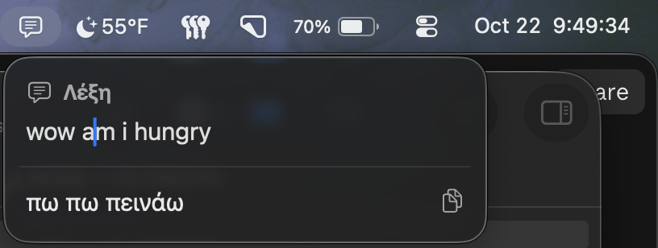

# Λέξη

A minimal macOS menu bar app for translating between Greek and English.



Type anything and press Return. Greek input translates to English, English translates to Greek — direction is detected automatically.

## How it works

Translation runs locally via a [LibreTranslate](https://github.com/LibreTranslate/LibreTranslate) server on `localhost:5005`, powered by Argos Translate models. No internet required after setup, no limits, no third-party services.

## Setup

### 1. Start the translation server

```bash
python3.12 -m venv ~/leksi-server
~/leksi-server/bin/pip install libretranslate
~/leksi-server/bin/libretranslate --load-only en,el --port 5005 --host 127.0.0.1
```

The server auto-starts on login via a LaunchAgent (installed separately).

### 2. Build and run

Open `Léksi.xcodeproj` in Xcode 16+ and press ⌘R. Requires macOS 14+.

## Requirements

- macOS 14+
- Xcode 16+
- Python 3.12 (for the translation server)
